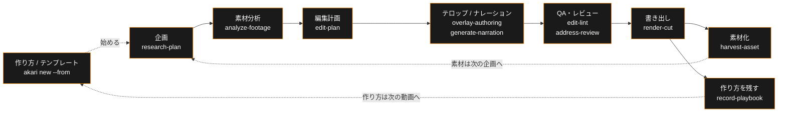

[English](./README.md) | **日本語**

**動画を投げるだけで、いい感じに編集されている。開いて確認して、直したいところだけ直す。**

**[akari.video](https://akari.video/)** — 公式サイト · **[ダウンロード](https://akari.video/download/)** · **[はじめかた](https://akari.video/start)** · **[AKARI Video Lab](https://akari.video/lab/)** — AI が理解して使える素材ライブラリ（無料 / Pro） · [使い方ガイド](https://akari.video/howto/)

AKARI Video は AI エージェントが編集の主体になる動画編集ツールです。
アプリは「編集する場所」ではなく「確認して直す場所」。素材を渡すと、分析・カット・テロップ・
ナレーション・BGM までエージェントが組み上げ、人間は仕上がりを見て意図とのズレだけを直します。

> **意図は人、手は AI。**

**Status: 安定版（v1.5.0）** — デスクトップアプリ（Theia ベースのシェル）が主な入口です。
ヘッドレス経路（opencode / Claude Code / Codex / Cursor Agent + スキル）も使えます。
NLE 書き出し（`export-nle`）など、一部の機能は BETA 表記のままです。

## なぜ作ったか

動画編集を AI に「時短のため」に投げると、誰が作ったかわからない量産コンテンツが出てくる。
かといって自分で全部やれば、カット・文字起こし・テロップ・整音で一日が終わる。

AKARI Video はその二択を壊すために作りました。

- **人間の役割は 2 つだけ** — 何を作りたいかを伝えること。仕上がりが自分らしいかを確認すること。
  それ以外（解析・カット判断・ドラフト・整形・検証）はエージェントが引き受ける
- **確認と微修正が最短距離** — 開いたらほぼ終わっている。タイムラインをゼロから組む画面ではなく、
  できあがった編集をレビューして、ドラッグと一言で直す画面
- **あなたの判断が残る** — 承認ゲートと決定ログで「どこを人間が決めたか」が常に追跡できる

## v1.5.0 の主な体験

- **作り方から始める** — 「＋ 新しい動画を始める」で開く「新しいプロジェクト」は 1 枚のポップアップ。名前とチャンネルを決めて、
  「白紙から」か「作り方から」を選びます。作り方は、1 本ぶんの手順・確認点・設定・仮枠のまとまりです。
  終わった動画からはスキル `record-playbook` で書き出せます。コマンドからは
  `akari new <フォルダ> --from <作り方>` で始められます
- **テンプレートを置いて、映像だけ差し替える** — ライブラリに「テンプレート」の棚があります。
  タイムラインへまとまり 1 つとしてドラッグし、空いている枠に自分の映像を落とすと、枠の尺のまま
  中身が入れ替わります。`akari template export` で書き出せます（v1.5.0 では `akari playbook template`）
- **プレビューの印が注釈に残る** — プレビューの下のペン・ピン・範囲で付けた印が、右パネルの注釈に
  なります。「AI に渡す」でパートナーに渡せます
- **シーン / 構成 / 関係** — 長い作品は 1 つのプロジェクトをシーンに分けて作れます。
  「シーン / 構成 / 関係」のタブで、プロジェクト → シーン → カットの木と、素材・スタイル・人物・
  文書のつながりを見られます
- **台本と字幕** — 台本パネルに予定とメモが時刻順に並び、タイムラインの最上段に「台本」の段が
  出ます。字幕スタイルは、字幕全体にも選んだ文字だけにも当てられます
- **トランジションを見本で選ぶ** — タイムラインのつなぎ目で、見本を見ながら選べます
- **UI 言語は ja / en** — 画面・同梱の素材・はじめてのガイドが、設定で選んだ言語に合わせて出ます
- **AI パートナー** — Claude Code と Codex を軸に、opencode・Cursor Agent・Muse Code CLI（Meta）
  ほかが使えます。パートナーの CLI は設定から更新できます

> [!NOTE]
> 配布中の v1.5.0 では、画面の語は旧名（オーバーレイ・マイスタイル・字幕テンプレ・ブランドキット）、CLI は旧名（`akari new --template`・`akari playbook template`）のままです。新名（動く部品・自分のスタイル・字幕スタイル・チャンネルの設定 / `akari new --scaffold`・`akari template export`）は次の版からです。CLI の旧名は以後も別名として残ります。

各版の詳細は [Releases](https://github.com/AkariLabs/akari-video/releases) にあります。

## 仕組み — セーブデータがすべて

エージェントと人間は同じセーブデータ（ファイル契約）の上で協働します。

  

- **`edit.json` が編集の SSOT** — エージェントはツール呼び出しの積み重ねではなく、
  セーブデータを直接読み書きする。速く、壊れず、diff で追える
- **表現がプリセットに閉じない** — 字幕・テロップ・図形・3D は AI が HTML/CSS/Three.js で自由に描ける。
  受け口は広いが、エンジンは合成だけ
- **人間の操作もデータに着地する** — ドラッグや値の調整は `edit.json`・data 属性・CSS 変数に
  書き戻される。人間と AI が同じファイル上で衝突しない
- **headless-first** — UI がなくても opencode、Claude Code、Codex、Cursor Agent だけで企画から書き出しまで完結する。
  アプリはあとから同じプロジェクトを開いて続きができる

ワークフローは段階ごとにスキル化されています:

書き出しは全 OS で `--engine auto` が既定です。GPU 適格なプロジェクトは GPU、
それ以外は OSR を選びます。`--engine gpu` または `--engine osr` で明示指定もできます。

## はじめる

初めての方は **[akari.video/start](https://akari.video/start)** から。アプリは
**[akari.video/download](https://akari.video/download/)** で入手できます。過去のバージョンは
[GitHub Releases](https://github.com/AkariLabs/akari-video/releases) にあります。

入口はいくつかあります。どの入口から始めても、同じファイル契約（`.akari/` 配下）に収束します。
途中でやめても、別の入口から「続きから」再開できます。

| 入口 | 実体 | 発動方法 |
|---|---|---|
| アプリ | Theia ベースのデスクトップシェル（macOS Apple Silicon / Windows）。`akari` CLI は自動で配備される | [akari.video/download](https://akari.video/download/) から入れて、ホームの「＋ 新しい動画を始める」 |
| ターミナル | ワンライナーインストーラー（フル構成 — ブラウザプレビュー込み）→ `akari.sh` | `curl -fsSL https://raw.githubusercontent.com/AkariLabs/akari-video/main/install.sh \| bash` — CLI だけ軽量に入れるなら `npm i -g akari-video` |
| opencode セッション内 | `.opencode/skills/` から自動発見 | 「新しい動画プロジェクトを作りたい」と発話 |
| Claude Code セッション内 | `plugin/` の `/akari` コマンド + SessionStart hook | セッション内で `/akari`、または「新しい動画プロジェクトを作りたい」と発話 |
| Codex セッション内 | `.codex/skills/` / `.agents/skills/` から自動発見 | リポジトリまたはプロジェクトフォルダを Codex で開き、「新しい動画プロジェクトを作りたい」と発話 |
| Cursor Agent | `.cursor/skills/`（モノレポ）またはプロジェクトのアダプタから自動発見 | リポジトリまたはプロジェクトフォルダを Cursor で開き、「新しい動画プロジェクトを作りたい」と発話 |

Claude Code プラグインとして入れる: `claude plugin marketplace add AkariLabs/akari-video` → `claude plugin install akari@akari`（[Getting Started §B](./docs/getting-started.ja.md#b-opencode--claude-code--codex-セッション内から)）。

> `npm i -g akari-video` は sudo を使いません。`EACCES`（権限エラー）が出た場合は
> 上記の `install.sh`（ユーザー領域・管理者権限不要）を使うか、npm のユーザー prefix を
> 設定してください。デスクトップアプリは `akari` CLI を自動配備するため、別途インストール
> する必要はありません。

最初の一歩は [docs/getting-started.ja.md](./docs/getting-started.ja.md) へ。

## Lab — 素材・スタイル・作り方

[AKARI Video Lab](https://akari.video/lab/) は、AI が理解して使える素材を無料 / Pro の 2 階層で
配っています。無料の素材は CC0、Pro の素材は AKARI 素材ライセンスです。アプリとの連携は
`akari store connect`。作り方の例 10 本（映画・短編ドラマ・MV・解説・商品紹介・Vlog・CM・教育・
切り抜き・ロゴ）は無料で、`akari store install <id>` で入れると「作り方から」の一覧に出ます。

## ドキュメント

- **[Introduction](./docs/introduction.ja.md)** — 思想と全体像
- **[Getting Started](./docs/getting-started.ja.md)** — 最初のプロジェクトを作る
- **[Guides](./docs/README.ja.md#guides)** — 「素材を分析する」「編集計画を立てる」「書き出す」などタスク別ガイド
- **[スキルカタログ](./docs/skills.ja.md)** — 28 スキルの一枚地図（各スキルの担当と接続先）
- **[How-to](./docs/README.ja.md#how-to)** — 接続と API キー・プロジェクト構成・続きから再開
- **[Reference](./docs/README.ja.md#reference)** — `edit.json` などファイル契約のスペック
- 入口: [docs/README.ja.md](./docs/README.ja.md)

## コミュニティ

- [Discord](https://akari.video/discord)
- [GitHub Issues](https://github.com/AkariLabs/akari-video/issues) — 不具合報告・機能要望

## Layout

- `apps/shell/` — Theia ベースのデスクトップシェル
- `packages/` — シェル非依存ライブラリ（schemas・frame engine・surface runtime・`akari-launcher`）
- `templates/` — プロジェクト scaffold（`.opencode/` 設定を含む）
- `skills/` — エージェント側ステージスキル（28 本）
- `plugin/` — Claude Code プラグインバンドル（スキルパック + SessionStart hook + `/akari`）
- `catalog/` — キュレーション済みアドオンカタログ（参照配布のみ）
- `docs/` — ユーザードキュメント + スペック契約

## License

コードは [MIT License](./LICENSE)。`assets/` / `catalog/` 経由で扱う素材は
それぞれの `meta.json` に記載されたライセンス表記に従います。同梱するサードパーティのバイナリ
（ffmpeg / ffprobe の GPL ビルド）は [NOTICE.md](./NOTICE.md) に記載しています。

---

## Star History

<a href="https://www.star-history.com/#AkariLabs/akari-video&Date">
  <picture>
    <source media="(prefers-color-scheme: dark)" srcset="https://api.star-history.com/svg?repos=AkariLabs/akari-video&type=Date&theme=dark" />
    <source media="(prefers-color-scheme: light)" srcset="https://api.star-history.com/svg?repos=AkariLabs/akari-video&type=Date" />
    
  </picture>
</a>

