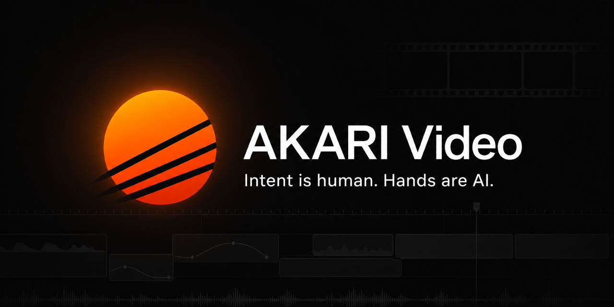
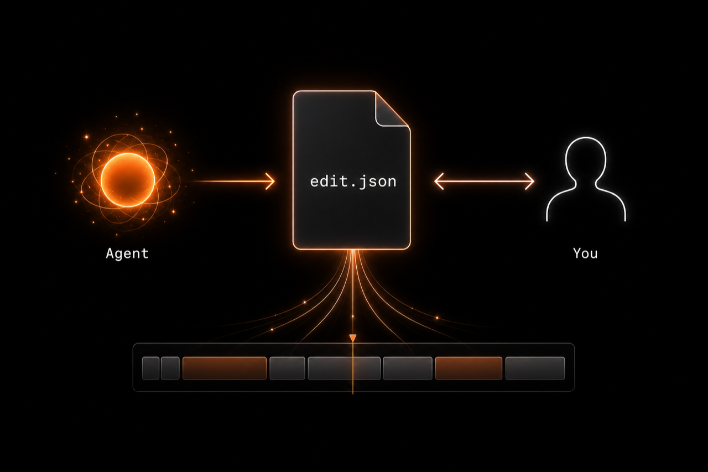
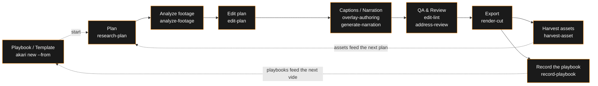

**English** | [日本語](./README.ja.md)

**Hand over your footage and it comes back edited. Open it, review it, fix only what matters.**

**[akari.video](https://akari.video/)** — official site · **[Download](https://akari.video/download/)** · **[Getting started](https://akari.video/start)** · **[AKARI Video Lab](https://akari.video/lab/)** — AI-ready asset library (free and Pro) · [How-to guide](https://akari.video/howto/)

AKARI Video is a video editor where an AI agent does the editing.
The app is not a place to edit — it is a place to review and fix. Give the agent your footage
and it assembles everything from analysis and cuts to captions, narration, and BGM, while you
look at the result and correct only where it drifts from your intent.

> **Intent is human. Hands are AI.**

**Status: stable release (v1.5.0)** — the desktop app (the Theia-based shell) is the main
entrance. The headless path (opencode, Claude Code, Codex, Cursor Agent + skills) works too.
Some features, such as NLE export (`export-nle`), are still marked BETA.

## Why this exists

Throw video editing at an AI "to save time" and you get mass-produced content nobody can call
their own. Do it all yourself and cutting, transcription, captions, and audio cleanup eat the
whole day.

AKARI Video was built to break that trade-off.

- **Humans do exactly two things** — say what you want to make, and check that the result
  feels like you. Everything else (analysis, cut decisions, drafting, formatting, verification)
  is the agent's job
- **Review-and-tweak is the shortest path** — the edit is nearly finished when you open it.
  Not a screen for building a timeline from scratch, but a screen for reviewing a finished edit
  and fixing it with a drag and a sentence
- **Your decisions stay on record** — approval gates and decision logs keep "what the human
  decided" traceable at all times

## What's in v1.5.0

- **Start from a playbook** — "+ Start a new video" opens a single "New project" popup: name, channel, then
  "Start blank" or "Start from a playbook". A playbook carries the steps, checkpoints, settings, and
  placeholder slots for one video. Record one from a finished video with the `record-playbook`
  skill, or start from the CLI with `akari new <dir> --from <playbook>`
- **Drop in a template, swap only the footage** — the Library has a "Templates" shelf. Drag a
  template onto the timeline as one unit, then drop your own footage into its open slots; the
  slot's length is kept. Export one with `akari template export` (`akari playbook template` in v1.5.0)
- **Marks on the preview stay as annotations** — pen, pin, and range tools under the preview
  land in the right panel as annotations. Hand them to your AI partner with "Hand to AI"
- **Scenes, structure, relations** — split a long project into scenes. A "Scenes / Structure /
  Relations" tab shows the project → scene → cut tree and how assets, styles, people, and
  documents connect
- **Script and captions** — the script panel holds planned items and notes in time order, with
  a "Script" row at the top of the timeline. Apply a caption style to all captions or only to
  the words you select
- **Pick transitions from samples** — choose a transition at a clip joint by seeing it first
- **UI language: Japanese / English** — the screens, bundled assets, and first-run guide follow
  the language you pick in Settings
- **AI partners** — Claude Code and Codex lead the list; opencode, Cursor Agent, Muse Code CLI
  (Meta), and others work too. Update partner CLIs from Settings

> [!NOTE]
> The v1.5.0 build still uses the older screen names (Overlays, Saved presets, caption templates, Brand kit) and the older CLI names (`akari new --template`, `akari playbook template`). The new names (Motion parts, My styles, caption styles, Channel settings; `akari new --scaffold`, `akari template export`) arrive in the next release. The older CLI names stay as aliases.

Details for each release are in [Releases](https://github.com/AkariLabs/akari-video/releases).

## How it works — the save file is everything

The agent and the human collaborate on the same save data (file contracts).

  

- **`edit.json` is the single source of truth** — instead of stacking tool calls, the agent
  reads and writes the save data directly. Fast, robust, diffable
- **Expression is not boxed in by presets** — captions, titles, shapes, and 3D can be drawn
  freely by AI in HTML/CSS/Three.js. The intake is wide open; the engine only does compositing
- **Human actions land in data too** — drags and value tweaks are written back to `edit.json`,
  data attributes, and CSS variables. Humans and AI share the same files without colliding
- **Headless-first** — everything from planning to export works with opencode, Claude Code,
  Codex, or Cursor Agent alone, no UI required. The app can open the same project later and
  continue

The workflow is packaged as skills, one per stage:

Export uses `--engine auto` by default on every platform. It selects GPU for eligible projects
and OSR otherwise. You can choose either path explicitly with `--engine gpu` or `--engine osr`.

## Getting started

New here? Start with **[akari.video/start](https://akari.video/start)**, then grab the app from
**[akari.video/download](https://akari.video/download/)**. Older versions are on
[GitHub Releases](https://github.com/AkariLabs/akari-video/releases).

There are several entrances. Whichever you start from, everything converges on the same file
contracts (under `.akari/`). Stop halfway and you can resume from any other entrance.

| Entrance | What it is | How to launch |
|---|---|---|
| Desktop app | Theia-based desktop shell (macOS Apple Silicon / Windows). Provisions its own `akari` CLI | Download from [akari.video/download](https://akari.video/download/), then "+ Start a new video" on Home |
| Terminal | One-line installer (full setup — browser preview included) → `akari.sh` | `curl -fsSL https://raw.githubusercontent.com/AkariLabs/akari-video/main/install.sh \| bash` — CLI only: `npm i -g akari-video` |
| Inside an opencode session | Skills auto-discovered from `.opencode/skills/` | Just say "I want to start a new video project" |
| Inside a Claude Code session | `/akari` command + SessionStart hook in `plugin/` | Type `/akari` in a session, or just say "I want to start a new video project" |
| Inside Codex | Skills auto-discovered from `.codex/skills/` / `.agents/skills/` | Open the repo or project folder in Codex and say "I want to start a new video project" |
| Inside Cursor Agent | Skills auto-discovered from `.cursor/skills/` (monorepo) or project adapters | Open the repo or project folder in Cursor and say "I want to start a new video project" |

As a Claude Code plugin: `claude plugin marketplace add AkariLabs/akari-video` → `claude plugin install akari@akari` ([Getting Started §B](./docs/getting-started.md#b-from-inside-an-opencode-claude-code-or-codex-session)).

> `npm i -g akari-video` never uses sudo. If it fails with `EACCES` (permission error),
> prefer `install.sh` above (user-space, no admin password needed) or configure an npm
> user prefix instead. The desktop app provisions its own `akari` CLI automatically —
> no separate install needed there.

First steps: [docs/getting-started.md](./docs/getting-started.md).

## Lab — assets, styles, and playbooks

[AKARI Video Lab](https://akari.video/lab/) distributes AI-ready assets in two tiers, free and
Pro. Free items are CC0; Pro items use the AKARI Assets license. Connect the app with
`akari store connect`. Ten example playbooks (film, short drama, music video, explainer,
product, vlog, ad, education, clips, logo) are free — install one with
`akari store install <id>` and it shows up under "Start from a playbook".

## Documentation

- **[Introduction](./docs/introduction.md)** — philosophy and the big picture
- **[Getting Started](./docs/getting-started.md)** — create your first project
- **[Guides](./docs/README.md#guides)** — task-based guides: analyze footage, plan the edit, export, …
- **[Skills Catalog](./docs/skills.md)** — the 28-skill map: what each owns and what it connects to
- **[How-to](./docs/README.md#how-to)** — connections & API keys, project structure, resuming a session
- **[Reference](./docs/README.md#reference)** — specs for file contracts such as `edit.json`
- Entry point: [docs/README.md](./docs/README.md)

> [!NOTE]
> Reference documents (data-contract specs and design notes) are currently Japanese-only.
> Opening an issue for a contract you need in English is welcome.

## Community

- [Discord](https://akari.video/discord)
- [GitHub Issues](https://github.com/AkariLabs/akari-video/issues) — bug reports and feature requests

## Layout

- `apps/shell/` — Theia-based desktop shell
- `packages/` — shell-independent libraries (schemas, frame engine, surface runtime, `akari-launcher`)
- `templates/` — project scaffolds (include `.opencode/` config)
- `skills/` — agent-side stage skills (28 of them)
- `plugin/` — Claude Code plugin bundle (skill pack + SessionStart hook + `/akari`)
- `catalog/` — curated add-on catalog (reference-only distribution)
- `docs/` — user docs + spec contracts

## License

The code is under the [MIT License](./LICENSE). Assets handled via `assets/` / `catalog/`
follow the license notice in each item's `meta.json`. Bundled third-party binaries
(ffmpeg / ffprobe, GPL builds) are documented in [NOTICE.md](./NOTICE.md).

---

## Star History

<a href="https://www.star-history.com/#AkariLabs/akari-video&Date">
  <picture>
    <source media="(prefers-color-scheme: dark)" srcset="https://api.star-history.com/svg?repos=AkariLabs/akari-video&type=Date&theme=dark" />
    <source media="(prefers-color-scheme: light)" srcset="https://api.star-history.com/svg?repos=AkariLabs/akari-video&type=Date" />
    
  </picture>
</a>

